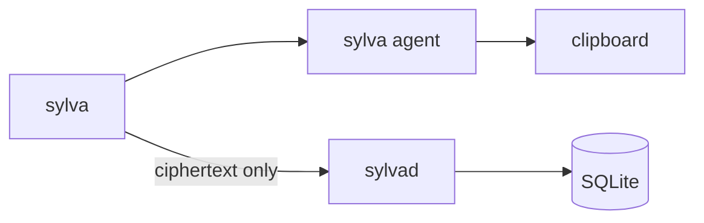

# Sylva


Password manager with self-hosted and Git storage backends. You encrypt secrets on your machine. The self-hosted `sylvad` server or a dedicated Git branch stores ciphertext. Subdomains can inherit a parent login (`mail.company.com` → `company.com`). `sylva get` copies a password to the clipboard and clears it after a timeout.



## How it works

The client derives a master key from your passphrase and a salt. The salt lives on the server. Records are sealed with AES-256-GCM before they leave the client. The server never sees plaintext.

Logins sit in a domain tree. `mail.company.com` can inherit `company.com` instead of storing another password.

`sylvad` is the HTTP server and SQLite store. `sylva` is the CLI and exits when the command finishes. `sylva agent` keeps the session key and clipboard after that. `get` starts the agent if it is not running.

Self-hosted storage remains the default. For Git, configure `backend=git`,
`git_remote` and `git_branch` in `.sylva/config`; no `sylvad` is needed.
Every successful write publishes one ciphertext-only commit, with concurrent
changes rejected instead of overwritten. See [Git setup](docs/howto.md#use-a-git-backed-vault)
for SSH access, history, migration and connectivity requirements.

Use `sylva profile create work` and `sylva switch work` to keep work and personal
accounts separate within the same backend. Profiles share the master passphrase
and SSH unlock session. See [profiles](docs/howto.md#work-and-personal-profiles).

Start with [setup](docs/setup.md), then use the [command and recovery how-to](docs/howto.md).
Remote access: [TLS 1.3 mTLS](docs/mtls.md) or [Tailscale](docs/tailscale.md).
Development checks and PR settings: [CI guide](docs/ci.md).
Fedora packages, systemd service and tag releases: [packaging guide](docs/packaging.md).

Plain HTTP is restricted to loopback. Remote access requires mTLS or the
embedded Tailscale listener with a restrictive tailnet policy. Docker Compose
requires mTLS certificates and publishes only to localhost by default.

The passphrase protects decryption; it is not API authorization. Callers with
access to the daemon API can mutate or delete the vault's ciphertext. Loopback
HTTP assumes local callers are trusted; accepted client certificates and
tailnet access policies grant access to the whole vault.

For a new mTLS setup, run `sylva cert init` to generate the certificates, then
`sylva enable mtls` and restart the daemon. Add `--host <DNS-or-IP>` to
`cert init` for a remote address. The [mTLS guide](docs/mtls.md) covers file
placement and Docker; certificate generation does not need OpenSSL.
For [Tailscale + mTLS](docs/tailscale.md#with-mtls), let the Tailscale-enabled
daemon join first, then use `cert init --add-tailscale` to include its full
MagicDNS name automatically before enabling mTLS and restarting.
For an existing bundle, `sylva cert add-tailscale` reissues only the server
certificate under the same CA, preserving other addresses and client files.
It needs the original CA signing key locally and a daemon restart afterwards;
see [existing certificate updates](docs/mtls.md#add-tailscale-to-existing-certificates).

## Use

Linux is the supported desktop. Install the Go toolchain specified in
`go.mod`, `make`, Python 3, Meson and Ninja. The default clipboard needs an accessible X11 display or
a Wayland compositor supporting `wlr-data-control`; it fails if neither is
available. Keep the session agent enabled for desktop copying.

From the project directory, create `.env` if it does not already exist, then
build and start the daemon in one terminal:

```bash
cp .env.example .env
make build
./bin/sylvad
```

In another terminal, from the same directory, run `init` for guided setup
(source, profile, master passphrase and optional SSH unlock):

```bash
./bin/sylva ping
./bin/sylva init
./bin/sylva set
./bin/sylva set company.com
./bin/sylva set mail.company.com --inherit
./bin/sylva set SYLVA_EXAMPLE env
./bin/sylva set 10.0.0.1 ssh
./bin/sylva set github-token password
./bin/sylva get mail.company.com
./bin/sylva get SYLVA_EXAMPLE env
./bin/sylva get 10.0.0.1 ssh
./bin/sylva get github-token password
./bin/sylva list
./bin/sylva update github-token password
./bin/sylva delete github-token password
./bin/sylva lock
```

You can also register a local Ed25519 SSH-agent key with
`sylva ssh add ~/.ssh/id_ed25519.pub` using the existing master passphrase,
then use `sylva unlock --ssh`. See the [SSH unlock guide](docs/howto.md#unlock-using-an-ssh-agent)
for device enrollment, supported keys and recovery behavior.

`set` with no args walks through type, credentials, and a hidden double password. Args skip those prompts: `set <id> [password] [type]`. A dotted name or IP defaults to domain. For a domain without a password, Sylva checks for a parent and asks about inherit.

`get <id> [type]` copies the secret to the clipboard. Domain names resolve
through inherit. Without a type, Sylva probes every kind and asks when the
result is missing or ambiguous; lookup failures are returned as errors.
Specify `password`, `domain`, `env`, or `ssh` to query only one kind. The agent
clears its unchanged clipboard selection after `clipboard_clear_after`
(default `20s`). Cleanup failures are reported; resolve the issue and retry
`sylva lock` before reusing the session.

`list` prints type and identifier only. `update` replaces an existing secret. `delete` removes one after confirmation.

Bind settings and secrets are in `.env`; leave the master passphrase empty
for interactive desktop use. Other defaults live in
`internal/config/default.conf`, with overrides in `.sylva/config` or process
environment. Keep the working directory consistent because default paths are
relative to it.

`sylva passwd` rotates the master passphrase. `sylva backup <new-file>` writes
an encrypted archive; `sylva restore <file>` recovers into an uninitialized
target. Follow the [recovery procedure](docs/howto.md#backup-and-recovery)
before pointing restore at a server.

## Verify changes

```bash
make check          # analyses, vulnerability scan, race and lifecycle tests
make coverage       # .coverage/coverage.out, coverage.txt and coverage.html
make fuzz FUZZTIME=30s
make docker-e2e     # isolated mTLS, rotation, backup and recovery checks
```

Docker E2E needs Linux, Docker Compose v2+, Python 3, and OpenSSL; it creates
its own certificates and disposable vaults. The older `docker-smoke` target
uses the configured Compose volume and needs preinstalled certificates and a
test passphrase. See [setup](docs/setup.md#tests) for Docker test options and
[CI](docs/ci.md) for job results and coverage artifacts.

Sylva is licensed under [GPL-3.0-only](LICENSE).
