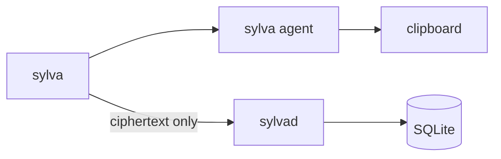

# Sylva


Self-hosted password manager. You encrypt secrets on your machine. `sylvad` only stores ciphertext. Subdomains can inherit a parent login (`mail.company.com` → `company.com`). `sylva get` copies a password to the clipboard and clears it after a timeout.



## How it works

The client derives a master key from your passphrase and a salt. The salt lives on the server. Records are sealed with AES-256-GCM before they leave the client. The server never sees plaintext.

Logins sit in a domain tree. `mail.company.com` can inherit `company.com` instead of storing another password.

`sylvad` is the HTTP server and SQLite store. `sylva` is the CLI and exits when the command finishes. `sylva agent` keeps the session key and clipboard after that. `get` starts the agent if it is not running.

## Use

```bash
cp .env.example .env
make build
./bin/sylvad
```

```bash
./bin/sylva init
./bin/sylva set
./bin/sylva set company.com 'secret'
./bin/sylva set SYLVA_EXAMPLE 'secret' env
./bin/sylva set 10.0.0.1 'secret' ssh
./bin/sylva get mail.company.com
```

`set` with no args walks through type, credentials, and a hidden double password. Args skip those prompts: `set <id> [password] [type]`. A dotted name or IP defaults to domain. For a domain without a password, Sylva checks for a parent and asks about inherit.

`get mail.company.com` resolves the login (including inherit) and copies the password to the clipboard. The agent keeps it until `SYLVA_CLIPBOARD_CLEAR_AFTER`.

Config is `.env`. Tests: `make docker-test` / `make docker-smoke`.

## Todo

- mTLS (flags only)
- Tailscale (flags only)
- Docs beyond this README
