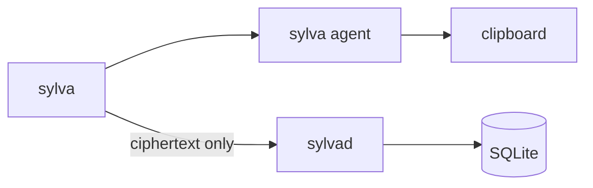

# Sylva


Self-hosted password manager. You encrypt secrets on your machine. `sylvad` only stores ciphertext. Subdomains can inherit a parent login (`mail.company.com` → `company.com`). `sylva get` copies a password to the clipboard and clears it after a timeout.



## How it works

The client derives a master key from your passphrase and a salt. The salt lives on the server. Records are sealed with AES-256-GCM before they leave the client. The server never sees plaintext.

Logins sit in a domain tree. `mail.company.com` can inherit `company.com` instead of storing another password.

`sylvad` is the HTTP server and SQLite store. `sylva` is the CLI and exits when the command finishes. `sylva agent` keeps the session key and clipboard after that. `get` starts the agent if it is not running.

Setup: [docs/setup.md](docs/setup.md). Optional TLS 1.3 mTLS: [docs/mtls.md](docs/mtls.md). Optional Tailscale: [docs/tailscale.md](docs/tailscale.md).

## Use

```bash
cp .env.example .env
make build
./bin/sylvad
```

```bash
./bin/sylva init
./bin/sylva unlock
./bin/sylva set
./bin/sylva set company.com 'secret'
./bin/sylva set SYLVA_EXAMPLE 'secret' env
./bin/sylva set 10.0.0.1 'secret' ssh
./bin/sylva set github-token 'secret'
./bin/sylva get mail.company.com
./bin/sylva get SYLVA_EXAMPLE env
./bin/sylva get 10.0.0.1 ssh
./bin/sylva get github-token
./bin/sylva list
./bin/sylva update github-token 'new-secret'
./bin/sylva delete github-token
```

`set` with no args walks through type, credentials, and a hidden double password. Args skip those prompts: `set <id> [password] [type]`. A dotted name or IP defaults to domain. For a domain without a password, Sylva checks for a parent and asks about inherit.

`get <id> [type]` copies the secret to the clipboard. Domain names resolve through inherit. If the type is omitted, Sylva looks up every kind. If it still cannot tell — or an IP could be a domain or ssh — it asks: password, domain, env, or ssh. The agent keeps the clipboard until `clipboard_clear_after`.

`list` prints type and identifier only. `update` replaces an existing secret. `delete` removes one after confirmation.

Bind and secrets are `.env`. Everything else is `internal/config/default.conf` plus `.sylva/config`. Tests: `make docker-test` / `make docker-smoke`.
